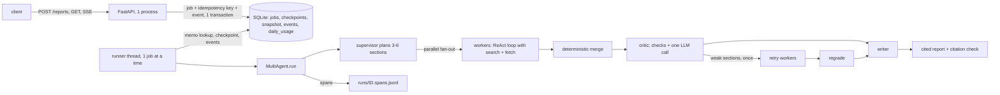

# Multi-Agent Research Reporter

Give it a topic. A supervisor plans the report, workers research the sections in parallel, a critic checks sources and gaps, and a writer assembles a cited Markdown report. The headline result will be a measured comparison against a single agent doing the same job: quality, cost and latency on 12 topics (not measured yet, see [Benchmark](#benchmark)).

**Demo:** demo link added after the Space is created.

**Status:** stages R0 to R3 are merged; R4 (service, jobs, streaming, traces, deploy) is in review. Build plan in [docs/plan.md](docs/plan.md); progress report in [docs/report.html](docs/report.html).

## Architecture



Every graph node is a memo: when it finishes, its output, a snapshot of the meter and the trace, and its progress events are saved in one SQLite transaction. After a crash the job starts again from the top of the graph with the same run id; finished nodes return their saved output, so only the unfinished workers run. Progress events are read from the same table, which is why a late subscriber gets the whole history and `Last-Event-ID` works after a restart.

Job states: `queued`, `running`, `succeeded`, `degraded` (a fallback output: quota, budget or writer failure), `failed`, `cancelled`. A terminal state never changes. Design notes: [R1](docs/design/r1.md), [R2](docs/design/r2.md), [R3](docs/design/r3.md), [R4](docs/design/r4.md).

## Patterns used and why

| Pattern | Where | Why |
|---|---|---|
| Supervisor and workers (fan-out and merge) | `agent/multi.py`, `agent/worker.py` | Sections are independent, so they can be researched in parallel; the merge is plain code, so source numbers never depend on completion order. |
| Critic with one bounded retry | `agent/critic.py` | Deterministic checks first (free), one LLM call for the rest; a weak section goes back to its worker once, never in a loop. |
| Writer that cannot invent sources | `agent/writer.py` | The model writes the body only; code builds the Sources list and the coverage notes, then checks every citation. |
| Fixed budgets and a cost ceiling per run | `budget.py` | Steps, tokens, seconds and cost are hard limits; agents stop researching at 70% so the critic and writer still have room. |
| Provider fallback and a shared cooldown | `llm/router.py`, `agent/llm_call.py` | The free tiers are rate limited; a 429 pauses every worker together instead of letting each one burn calls. |
| Memoised nodes in SQLite (checkpoints) | `service/store.py`, `agent/checkpoint.py` | A multi-minute run must survive a restart; the meter, trace and router summary live outside the graph, so a side store is needed anyway. |
| Idempotent job creation | `POST /reports` | A client that retries after a timeout must not start a second, quota-eating run. |
| The database is the queue | `service/runner.py` | One container, one runner thread, no broker; queued jobs survive restarts. |
| Server-sent events from persisted events | `service/sse.py` | One source of truth for live view, history and resume. |
| OpenTelemetry spans with Langfuse-compatible attributes | `otel.py`, `service/telemetry.py` | Tokens, model and cost per call and per worker, without prompts, and without running a Langfuse server. |

## Benchmark

Single agent versus multi-agent system on the 12 topics in `evals/topics.jsonl` (2 runs per topic and system). **Results: not measured yet.** No number is reported here until the benchmark has been run; the figures will come from `results/benchmark.json`, each with its sample size.

What has been measured so far are small smoke runs, not a benchmark (n = 1 per topic and system, on free-tier quotas):

- `results/baseline_smoke.json`: 2 topics, 3 attempts, 1 run without a usable report.
- `results/r1_smoke.json`: 2 topics, 2 runs, 1 usable digest (the other had 0 of 5 sections complete).
- `results/r2_smoke.json`: 2 topics, 2 runs, 0 runs with a written report (both degraded to a placeholder; the free quota was rate limited).

```bash
uv run reporter ping                                # is any provider's quota available?
uv run python evals/run_benchmark.py --dry-run      # print the plan, call nothing
uv run python evals/run_benchmark.py --max-runs 4   # run a few; finished runs are skipped next time
uv run python evals/aggregate.py                    # write results/benchmark.json
uv run python evals/make_pairs.py                   # 6 blind pairs for you: evals/pairs_to_rate.md
uv run python evals/judge_pairs.py                  # judge those pairs, compare with evals/pairwise_human.jsonl
```

The same commands exist as `uv run reporter bench run|aggregate|make-pairs|judge-pairs`. Options of `run`: `--topics`, `--systems`, `--runs-per-topic`, `--max-runs`, `--swap-check`, `--retry-failed`, `--no-score`.

- Resumable: one record per (topic, system, run) in `results/benchmark_runs/`, raw traces in `runs/benchmark/` (git-ignored). When every provider is out of its per-day quota the script stops with exit code 3 and records the remaining runs as `not_run`; run it again after the reset.
- A run without a written report is a failed run. It stays in the failure rate and in the cost per successful report.
- The manual workflow `.github/workflows/benchmark.yml` (Actions, "Run workflow") runs the same script with the repository secrets and commits the results to the `results` branch.
- Design: [docs/design/r3.md](docs/design/r3.md).

## Cost per report

Not measured. The Gemini and Groq free tiers are unpriced in the cost model, so `cost_usd = 0.0` in a trace means "unpriced", not "free of cost". The service therefore reports `cost_usd: null` for a run that has an unpriced call, and the OpenTelemetry cost attribute is left out rather than set to 0. Token counts are measured per run and are in each trace.

The demo's per-run limits (starting values, not measured): 40 steps, 150 000 tokens, 360 s, 0.05 USD, 2 parallel workers; daily cap 2 jobs and 400 000 tokens (UTC day).

## A real failure from the PRs: the 169 s PDF

In R0 the single-agent baseline on "carbon capture: current costs and limits" ended with `budget_seconds`, 0 sources and the placeholder report "No report could be written" (`results/baseline_smoke.json`: 247.9 s, 1 run). The trace showed why: the agent had picked a PDF, `fetch_page` downloaded all of it (169 s, as recorded in the R1 design and in `docs/report.html`) and only then rejected it because it was `application/pdf`. The whole time budget went on a page that was never usable.

The fix, in R1 (`src/reporter/tools/fetch.py`, [design](docs/design/r1.md)): read the `Content-Type` from the response headers before reading the body, so a PDF is refused before it downloads; add a total deadline checked in the download loop; use a short connect timeout. In the R1 smoke (`results/r1_smoke.json`, n = 1 per topic) `pdf_fetch_errors` is 0 for both topics. The same topic still produced a digest with 0 of 5 sections complete in that run, so the PDF was one cause of the failure, not the only one; this README does not claim the other cause.

## How to run

Needs [uv](https://docs.astral.sh/uv/). Keys go in `.env` (git-ignored); only the names are listed here: `GEMINI_API_KEY`, `GROQ_API_KEY`, `TAVILY_API_KEY` (see `.env.example`).

```bash
uv sync                                   # install
uv run reporter ping                      # one tiny call to each provider
uv run reporter multi "state of solid-state batteries" --out report.md
uv run reporter baseline "topic"          # the single-agent baseline
uv run ruff check . && uv run ruff format --check . && uv run pytest   # make lint, make test
```

### Optional third-party gateway

`agentrouter` (an OpenAI-compatible chat-completions gateway, `https://agentrouter.org/v1`) can be added as the last provider. It is a third-party proxy: the operator is unidentified and no data policy is stated, so prompts and fetched page text sent to it leave your control. It is not used by default and is not recommended for the benchmark.

It joins the model chain only when all of these are set: `REPORTER_EXTRA_PROVIDERS=agentrouter`, `AGENTROUTER_API_KEY` and `AGENTROUTER_MODEL` (no default; `AGENTROUTER_BASE_URL` is optional). `uv run reporter ping` tests it whenever the key is set, even when it is not in the chain. Each benchmark run record carries `gateway_used`, and `results/benchmark.json` notes any run that used it, so results always say which provider answered. When the gateway answers an error, the `reporter ping` line adds `hint=<cause>` (one of `invalid_token`, `token_disabled_or_expired`, `no_credit`, `client_not_allowed`, `model_not_allowed`, `model_unavailable`, `rate_limited`, `ip_blocked`, `unknown`), chosen from a fixed list so no part of the response body is ever shown.

### The service (API)

```bash
uv run uvicorn reporter.service.app:app --port 7860     # or: make serve
curl -s -X POST localhost:7860/reports -H 'Content-Type: application/json' \
     -H 'Idempotency-Key: my-key-0001' -d '{"topic": "state of solid-state batteries"}'
curl -s localhost:7860/reports/<id>                      # state, progress or result
curl -N localhost:7860/reports/<id>/events               # live progress (SSE)
curl -s -X DELETE localhost:7860/reports/<id>            # cancel
curl -s localhost:7860/quota                             # today's counters
```

| Endpoint | Purpose |
|---|---|
| `POST /reports` | Start a job: 202 with `{id, state, links}`. `Idempotency-Key` (8-128 chars) makes a retry return the same job (200); the same key with another body is 409. At most 3 jobs wait; a full queue, the daily cap, a provider quota and a per-IP rate limit answer 429. |
| `GET /reports/{id}` | `queued` (position), `running` (progress), or the result with budget and trace summary. |
| `GET /reports/{id}/events` | SSE: `queued`, `started`, `plan`, `worker_done`, `critic_verdict`, `retry`, `written`, `quota`, then `done` or `failed`. Resume with `Last-Event-ID` or `?after=n`. |
| `DELETE /reports/{id}` | Cancel (a running job stops at the next node). |
| `GET /reports/{id}/trace` | The OpenTelemetry spans of a finished job. |
| `GET /health`, `GET /quota`, `GET /` | Liveness (with `storage: persistent\|ephemeral`), daily counters, a small demo page. |

Answers carry fixed reason codes and texts only: no raw provider error, key, IP or idempotency key. Settings come from the environment (`REPORTER_DATA_DIR`, `DAILY_MAX_JOBS`, `DAILY_MAX_TOKENS`, `RUN_MAX_TOKENS`, `RUN_MAX_SECONDS`, `MAX_WAITING`, `TRUST_PROXY_HOPS`, `CORS_ORIGINS`, ...; see `src/reporter/service/config.py`). Data lives in `REPORTER_DATA_DIR`, else `/data` if writable, else `./var` (then `/health` says `storage: ephemeral` and a restart can lose jobs).

### Docker

```bash
docker build -t research-reporter .
docker run --rm -p 7860:7860 -v reporter-data:/data \
  -e GEMINI_API_KEY -e GROQ_API_KEY -e TAVILY_API_KEY research-reporter
```

The image is `python:3.12-slim`, runs as uid 1000, one uvicorn worker (the queue, the rate limits and the quota latch live in that process), no dev dependencies. It has not been built in this repository's CI yet.

### Deploy to a Hugging Face Docker Space

`.github/workflows/deploy.yml` runs on every push to `main` (and by hand): lint and tests, then it copies only the files the image needs (`Dockerfile`, `pyproject.toml`, `uv.lock`, `src/`, and `deploy/space_README.md` as the Space `README.md`) to the Space and polls `/health` for up to 15 minutes. Setup, once:

1. Create a Docker Space on Hugging Face and set the repository variable `HF_SPACE_ID` to `owner/name`.
2. Add the repository secret `HF_TOKEN` (a write token). Without it the workflow prints a notice and skips the deploy.
3. In the Space settings add the secrets `GEMINI_API_KEY`, `GROQ_API_KEY`, `TAVILY_API_KEY`; enable persistent storage if you want a crashed job to resume after a Space restart.

### Traces

Each service run appends its OpenTelemetry spans to `runs/<id>.spans.jsonl` (spans for the job, each node and worker, each model call and each tool call, with `gen_ai.*` and `langfuse.*` attributes; no prompts). `uv run python scripts/export_trace.py <run_id> --real|--synthetic` writes one run to `docs/traces/example.json`. **The example currently in the repository is synthetic** (`"synthetic": true`): it comes from a run with a fake model and fake tools, so its numbers are not measurements. A real one replaces it after an end-to-end run.
