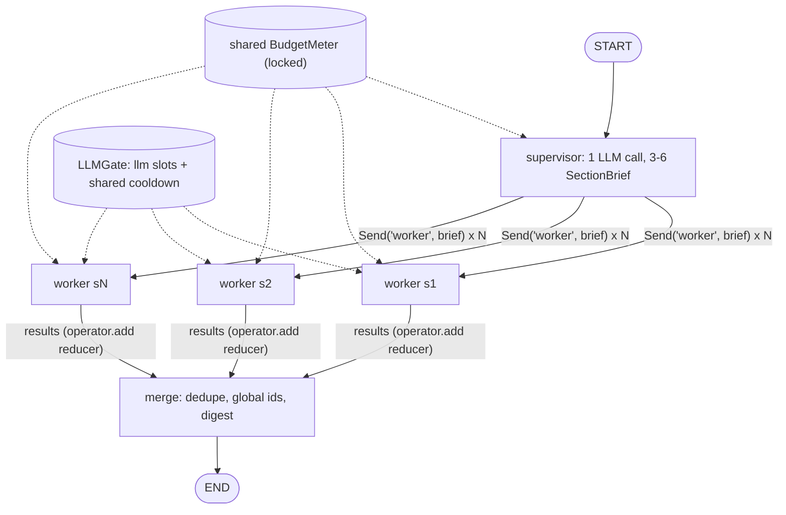

# R1 design: supervisor and parallel workers

**Goal.** A supervisor turns the topic into 3-6 self-contained section briefs, and LangGraph `Send` fans them out to workers that research in parallel (short ReAct loops with the R0 tools) under one shared run budget. A deterministic merge step joins the structured worker results into one research record with stable global source numbers, ready for the R2 critic and writer.

## Graph

Inside a worker (plain Python loop, not a subgraph): `think -> act -> think ... -> finalize`. Attempt 1 failed -> attempt 2 with a failure note -> else `incomplete`. `graph.invoke(..., {"max_concurrency": max_parallel_workers})` limits how many workers run at once.

## Files: reused and changed

- **Reused as is:** `parsing.extract_json`, `Decision`, `tools.call_tool/describe/default_tools`, `pricing.call_cost_usd`, `llm.build_default_llm`, `cli.load_env_file`, `tests/fakes.py`.
- **Moved:** `BaselineAgent._generate` and `_add` go to `agent/llm_call.py` as `generate_charged(llm, step, prompt, system, max_tokens, meter, gate=None)`. Baseline calls it with no gate; its tests must stay green unchanged.
- **New:** `agent/schemas.py` (models below), `agent/worker.py` (`run_worker`), `agent/multi.py` (`MultiAgent`, `parse_plan`, `merge_results`, `render_digest`), prompts `SUPERVISOR_*`, `WORKER_THINK_*`, `WORKER_FINAL_*` in `prompts.py`.
- **Changed:** `budget.py` (thread lock in `add_step/add_call`, new `hard_limit_reached()` = any limit at 100%); `trace.py` (fields below, lock in `add_step`, which also assigns `index`); `tools/fetch.py` (see failures); `llm/router.py` one line: `raise AllProvidersFailedError(...) from last_error` so the gate can see a rate limit through `__cause__`; `cli.py` (`multi` subcommand).

## Schemas (Pydantic unless noted)

- `SectionBrief`: `id: str` ("s1".."s6"), `title: str`, `goal: str`, `scope: list[str]` (1-4 points to cover), `exclude: list[str]` (what not to cover; usually the other sections), `expected_output: str` (e.g. "3-6 findings with numbers and dates"). Rendered with the topic and today's date so a worker needs nothing else.
- `Finding`: `claim: str`, `source_ids: list[int]` (worker-local 1-based in a worker result; global after merge).
- `WorkerResult`: `section_id: str`, `index: int`, `status: Literal["complete","incomplete"]`, `findings: list[Finding]`, `pages: list[Page]` (fetched only, in fetch order), `confidence: Literal["low","medium","high"]`, `open_questions: list[str]`, `attempts: int`, `stop_reason: str`, `error: str | None`.
- `MergedResearch`: `sources: list[SourceRecord]` (global, id 1..K), `pages: dict[str, Page]` (url -> page, for R2), `sections: list[SectionOut]` (`brief`, `status`, `confidence`, `findings` with global ids), `open_questions: list[tuple[str, str]]` (section_id, question), `incomplete: list[str]`, `dropped_citations: int`.
- Graph `State` (TypedDict): `topic: str`, `sections: list[SectionBrief]`, `results: Annotated[list[WorkerResult], operator.add]`, `merged: MergedResearch | None`, `digest: str`. Send payload `WorkerInput` (TypedDict): `brief: SectionBrief`, `index: int`.
- `MultiBudget` (dataclass): `run: Budget = Budget(max_steps=36, max_tokens=300_000, max_seconds=480, max_cost_usd=0.50)`, `worker_max_steps=6`, `worker_max_tokens=50_000`, `worker_max_seconds=150` (per section, both attempts), `tool_max_seconds=20`, `max_pages_per_worker=4`, `min_sources=2`, `max_parallel_workers=3`, `max_parallel_llm_calls=2`. These are starting defaults, not measured values.
- Trace additions: `system="multi"`; `sections: list[dict]` (briefs); `workers: list[WorkerRecord]` with `section_id, attempt, status, started_s, ended_s` (seconds since run start, same monotonic clock as the meter), `started_at` (ISO), `steps, tokens, cost_usd, n_pages, stop_reason, error`; `rate_limit_waits: list[{section_id, at_s, waited_s}]`; `concurrency: {max_parallel_workers, max_parallel_llm_calls}`. `StepRecord` gets `worker: str | None` and kind `"finalize"`. Existing `sources`, `coverage` (section title -> pages), `report` (the digest) and `stop_reason` are reused.

Shared objects (meter, gate, trace, clock) live on the `MultiAgent` instance, not in graph state: they are not serializable. R4 checkpointing must rebuild them on resume.

## Nodes

| Node | Receives | Returns | Budget |
|---|---|---|---|
| supervisor | `topic` | `sections` (3-6 briefs) | 1 LLM call (+1 retry), 1 500 output tokens, no tools |
| worker | `WorkerInput` | `{"results": [WorkerResult]}` | per section: 6 think steps + 1 finalize, 50k tokens, 150 s, 20 s per tool call, max 4 pages; plus the shared run meter |
| merge | `sections`, `results` | `merged`, `digest` | no LLM, pure function |

- **supervisor:** prompt asks for JSON `{"sections": [{title, goal, scope, exclude, expected_output}]}`. `parse_plan(text, topic)` validates each item, drops invalid ones and duplicate titles (casefold), keeps the first 6, assigns ids in order. Fewer than 3 valid: one retry with an error hint at temperature 0.7. Still fewer than 3: keep them if at least 1 (trace note `plan_short`), else use 3 generic briefs (background and current state; numbers and evidence; limits, risks and outlook).
- **worker:** each think step returns a `Decision` (`web_search`, `fetch_page`, `finish`; `answers` is ignored). Research stops at: model `finish` with >= `min_sources` pages (refused once below that), `max_pages_per_worker` reached, worker steps or 80% of worker time/tokens, `meter.stop_reason()` of the shared run, or 3 unparseable replies in a row. Then **finalize**: one call with the brief and the numbered fetched pages (2 500 chars each) returning `{"findings": [{"claim","sources":[int]}], "confidence", "open_questions"}`, max 8 findings. Our code drops any source number that is not a fetched page (rule: a source counts only if fetched), drops findings left with no source, and caps confidence at `low` when fewer than 2 pages were fetched. `complete` = at least one finding left.
- **merge:** sorts results by `index` (completion order is random, numbering must not be), walks pages in that order and gives each new normalized URL (lowercase host, no fragment, no trailing slash) the next global id, remaps finding ids, dedupes open questions (casefold), adds an `incomplete` section for any brief with no result. `render_digest` writes Markdown: one `##` per section with status and confidence, findings as bullets cited as `[3][5]` (never grouped `[3, 5]`), open questions, and a `## Sources` list. No LLM writer in R1.

## Shared budget and concurrency

- One `BudgetMeter` for the run, with a lock. Before every LLM call `generate_charged` checks `meter.hard_limit_reached()` and raises `BudgetExhausted` if so; at 80% (`stop_reason()`) workers stop researching but may still finalize. Overshoot is bounded by the calls already in flight (at most `max_parallel_llm_calls`).
- `LLMGate`: a `threading.Semaphore(max_parallel_llm_calls)` around every `llm.generate`, plus a shared `cooldown_until`. Tools run outside the gate, so one worker can fetch while another thinks.
- Rate limit: if a call fails with `RateLimitError` (directly or as `__cause__` of `AllProvidersFailedError`), the gate sets `cooldown_until = now + 10 s` (20 s on the next one, capped at 30 s and at the worker's remaining time). Every worker waits before its next call, the wait goes into `rate_limit_waits`, and the call is retried once. A second failure fails the attempt.
- Free-tier calls are unpriced (cost 0.0 in R0), so in smoke runs the token and time limits bind, not the cost ceiling. The trace says so through `calls_without_price`.

## Failure handling

| What fails | What happens |
|---|---|
| Supervisor reply empty, bad JSON, or < 3 sections | Retry once, then short plan or 3 generic briefs (see supervisor). The run goes on. |
| Worker attempt raises (`ProviderError` after the gate retry, any exception) or ends with 0 fetched pages or finalize stays unparseable after 1 retry | Retry once with the note "previous attempt failed: <reason>; avoid these URLs: ..." if the run is below 80% and at least 30 s of section time is left. Then `incomplete`, keeping the attempt with more pages. |
| `BudgetExhausted` | No retry (retrying cannot help). The section ends `incomplete` with what it has. |
| Tool error (404, bot wall, PDF, timeout) | Same as R0: the model sees an `ERROR` observation and adapts. Not an attempt failure. |
| Slow download (the 169 s PDF in R0) | `fetch.py`: check `content-type` from the headers before reading the body (PDFs are refused before download); a total deadline of `tool_max_seconds` checked in the chunk loop; `httpx.Timeout(10, connect=5)`. |
| Worker node bug escapes | `run_worker` catches everything, so a node never raises. Merge also covers a missing result. |
| Whole run raises | As in R0: the trace is saved in `finally` with `error` set. |

## Tests (fake LLM, fake tools, no network)

1. `parse_plan`: valid 4 sections; fenced JSON; more than 6 cut to 6; invalid items and duplicates dropped; 0 valid gives the 3 generic briefs; ids are s1..sN in order.
2. Brief rendering contains topic, date, goal, scope, exclude and expected output.
3. Worker: an unfetched or out-of-range source number is dropped; a finding with no source left is dropped; confidence is capped with 1 page; `finish` with too few pages is refused once.
4. Parallel: 3 sections whose fake fetch waits on `threading.Barrier(3, timeout=5)`. The test passes only if all 3 run at once, and the trace `workers` intervals overlap. With `max_parallel_workers=1`, a lock-protected in-flight counter never goes above 1.
5. Failure: attempt 1 raises and attempt 2 succeeds (`attempts=2`, `complete`). Both attempts fail: `incomplete`, the other sections are `complete`, the digest marks it, and the run returns normally. 0 pages counts as a failure.
6. Rate limit: a fake LLM raises `RateLimitError` once. One cooldown is recorded (fake sleep), the call is retried and the worker completes.
7. Budget: an injected `cost_fn` charges $0.004 per call against a $0.01 ceiling. No call starts after the ceiling, total cost <= ceiling + `max_parallel_llm_calls` x 0.004, and no retry after `BudgetExhausted`.
8. Merge: the same URL in two sections gets one global id; ids are the same when the results list is shuffled; finding ids are remapped; the digest uses only `[n]` and every n is in Sources.
9. Fetch: an `httpx.MockTransport` PDF response is refused with 0 body chunks read; a slow stream with a fake clock stops at the deadline.
10. Trace: steps from concurrent workers have unique indexes and a `worker` id. The CLI `multi` parses its flags, and `main` runs with a patched agent.

## Design choices

1. **Retry inside the worker node, not by a graph re-dispatch or LangGraph `RetryPolicy`.** `RetryPolicy` only fires on exceptions, but "0 pages fetched" is also a failure, and each attempt needs its own trace record and a note for the next one. A second `Send` round would need a barrier node and loop logic that R2 (critic sends back) will add anyway.
2. **The worker loop is plain Python inside one node, not a LangGraph subgraph per worker.** This gives one node and one timing interval per section, which is easy to cap and to draw as a Gantt bar. A subgraph would add checkpoint and recursion-limit details with no gain until R4.
3. **Workers cite with local numbers and merge assigns global ids, rather than workers citing URLs.** Small numbers are harder for the model to garble than URLs, unfetched sources are dropped by construction, and sorting by section index makes the numbering stable for R2's checks.

## Deviations from docs/plan.md and what is left for R2

- Deviations: R1 writes a deterministic digest, not an LLM-written report (the writer is R2). It also fixes the R0 fetch tool (header check, total deadline) and changes one line in the copied router. Supervisor fallback can give fewer than 3 sections, with a trace note.
- Left for R2: the critic, the writer, deterministic citation checks (including grouped `[5, 6]`), contradiction checks, and sending weak sections back after critic feedback.
