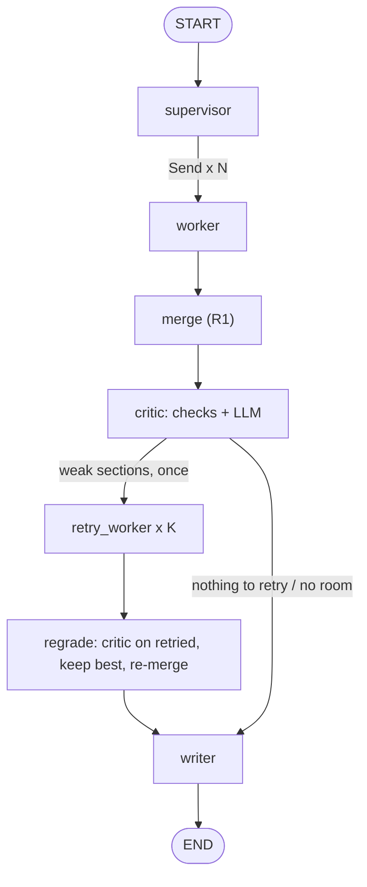

# R2 design: critic, one retry round, writer

**Goal.** After the R1 merge, check the research (deterministic checks, then an LLM critic), send weak sections back to their worker once, keep the best attempt, and let a writer produce the final cited Markdown report. Free-tier capacity is the bottleneck, so every model call goes through `generate_charged` (shared meter and LLM gate) and every LLM step has a deterministic fallback.

## Graph

There is no loop: the retry branch is traversed at most once, so a section is retried at most once by construction. `retry_candidates()` also refuses sections already in `retried` (tested).

## State additions

`review: Review | None`, `retried: list[str]`, `retry_results` (reducer `operator.add`, like `results`), `report: str`. `WorkerInput` gets an optional `feedback: str`. `SectionOut` gets `n_pages` and `stop_reason`. `MultiRunResult` gets `review` and `digest` (`report` is now the final report). The digest stays reachable with `critic=False, writer=False` (CLI `--no-critic --no-writer`).

## Checks (`agent/checks.py`, no LLM)

- `citation_numbers(text)` parses `[5]`, `[5, 6]`, `[5][6]`, `[5-7]`, `[5,7-9]` (also en/em dash and `;`); also used by the R0 checker.
- `check_citations(text, sources, fetched_urls)` returns `invalid_citations` (number not in the global list), `uncited_sources`, `unfetched_urls` (cited sources, and URLs written in the body, that no `fetch_page` call or fetched page of this run produced; URLs are normalized).
- Per section: no fetched page or no finding -> verdict `fail`, issue from `deterministic`, no LLM call.

## Critic (`agent/critic.py`)

Rubric: 1 every claim sourced, 2 sources support the claim, 3 no contradiction between sections, 4 coverage of the plan. Input per section: brief, findings with global ids, and for each cited source a 900-char excerpt chosen by word overlap with the claims. Reply:
`{"sections": [{"id", "verdict": "pass"|"weak"|"fail", "issues": [{"rubric": 1-4, "issue", "evidence"}]}], "contradictions": [{"sections": [ids], "issue", "evidence"}], "coverage_gaps": [str]}`.
Parse failure: one more try at temperature 0.7 (empty replies are already retried inside `generate_charged`). Still failing, or `ProviderError` / `BudgetExhausted`: sections get `unreviewed`, trace note `critic_failed: <reason>`, deterministic verdicts stand. A section missing from the reply is `unreviewed`.

## Retry rules

- Candidates: verdict `weak` or `fail` (deterministic or critic), not yet retried, at most 3 (worst first). The gate checks what a retry needs, not the 70% line: no limit past 85%, at least 30 s left before 85% of the time limit, and about 3 run steps per retried section (`_retry_capacity`). A retry worker stops researching at 90% (`WorkerContext.stop_fraction`), research proper at 70%.
- The retry worker runs one attempt (`max_attempts=1`) with the issues as feedback and the URLs already read.
- The retried sections are criticised again (same function, only those sections). "Best" is deterministic: `(verdict rank, fetched pages, findings)` with rank fail 0 < weak 1 < unreviewed 2 < pass 3; the retry replaces the original only if strictly better. The final merge is redone from the chosen results, so global source numbers follow section order.

## Budget

`MultiBudget.run.stop_fraction` is 0.7 and the run step limit is 60 (was 36, which 5 sections exhausted before the retry; first smoke run): workers stop researching at 70% of any limit, the last 30% is for critic, regrade and writer, which still stop at 100% (`enforce_limit`). The CLI passes this fraction through.

## Writer (`agent/writer.py`)

Input: findings with global ids, open questions, critic contradictions and gaps, the numbered source titles (no page text, to save tokens). The model writes the body only; code strips any Sources section it wrote, appends the Sources list from the global list, and appends a code-built "Coverage notes" section naming missing and weak sections. No usable finding anywhere: no LLM call, a short "No report could be written" text. Writer failure (provider error, budget, empty twice): the R1 digest with a warning line. The final text goes through `check_citations`.

## Report text hygiene

Nothing raw reaches the report: `plain_reason()` maps errors and stop reasons to short phrases (rate limited, model output unusable, step budget reached, time limit reached, ...), `clean_text()` strips URLs and `[internal_tokens]` from model-written lines. Detail stays in the trace (worker errors, `writer_error` note). The same applies to the digest fallback.

## Unverified claims

Findings that a critic issue of rubric 1 or 2 names as `F<n>` are left out of the writer prompt (decided in code) and listed in Coverage notes as unverified, with a per-section critic issue count. Issues that name no finding are only counted.

## Reliability fixes (second round)

- **Groq (provider level):** for gpt-oss the request leaves a temperature below 0.5 to the server default (R0: low temperatures gave reasoning-only replies), sets `reasoning_effort="low"` and `include_reasoning=False` (both supported by the installed SDK), and adds 600 completion tokens of headroom. The router treats an empty reply as `EmptyReplyError` (a `ServerError`: retried with backoff, then the next provider) and counts it once in `empty_replies`.
- **Router diagnosis:** every failed attempt is recorded as `{provider, reason (class + status), attempt}`; `AllProvidersFailedError` now names them without raw text; `summary()` (providers, calls, failures by reason, empty replies) goes to `trace.llm`. There is no sticky "dead provider" state: a rate-limited provider is tried again on the next call.
- **Fetch:** 403/429 is retried once with browser-like headers; a second block says to pick a different search result.
- **Worker:** URLs of search results are kept as candidates (PDFs and hosts that answered 403/429 are dropped); failed and repeated fetches tell the model which candidates remain. A retry (and a second attempt) starts with a model-free fetch of the best untried candidate, and its brief lists failed URLs with reasons and asks for a rephrased query.
- **Critic and writer:** the critic reads up to 2 000 characters per source, with 3 600 shared by a section's sources (token-per-minute limits). A claim a critic issue names without quoted evidence is kept in a code-built "Unverified claims" section, labelled unverified; it is omitted from the text (and listed in Coverage notes) only when the issue quotes evidence.

## Writer output rules (fourth round)

Code enforces these on the writer reply (`sanitize_body` in `agent/writer.py`); the counts go to `trace.writer`
(`stray_tokens`, `assurance_lines`, `dropped_sections`, `uncited_bullets`, only when non-zero).

- Bracketed non-numeric tokens (`[Critic]`, `[budget_steps]`) are removed. Code-built notes use plain words.
- A section with no usable findings gets no prose; it appears only in Coverage notes.
- A bullet under a section heading with no `[n]` citation is dropped (conservative); a section left empty is dropped.
- Model-written blanket assurances ("all statements are sourced") are removed. Code adds one line from the data:
  "N claims cited, M claims left out or marked unverified, K sections missing or weak."
- Missing-section reasons come from `section_reason` (pages, stop reason, error). "Refused (HTTP 403 or 429)" is
  said only when a fetch really returned that status (`SectionOut.blocked_fetches`).

## Trace additions

`critic` ({status, before, after, final verdicts, issues, contradictions, coverage_gaps}), `retries` (per section: before/after verdict, pages, findings, `kept`), `writer` ({status, reason}), `checks` (top level `invalid_citations`, `uncited_sources`, `unfetched_urls` of the final text, plus `research` per-section checks and `stage`), `notes`. Step kind `critic` added.

## Limit types, baseline parity and `reporter ping` (third round)

- **Limit type of a 429** (`llm/limits.py`): the provider layer classifies a 429 into one of `per_minute_tokens`, `per_minute_requests`, `per_day_tokens`, `per_day_requests`, `quota_exhausted`, `unknown`, plus an optional `retry_after_s`. Groq: from the `(TPM|RPM|TPD|RPD)` code (or the words "per minute/day", "tokens/requests") and "try again in ..." in its message. Gemini: from `error.details` (QuotaFailure `quotaId`/`quotaMetric`, RetryInfo `retryDelay`); a quota with no period in it is `quota_exhausted`. Only the enum and the delay are kept on the error (`ProviderError.limit`, `.retry_after_s`); the message is dropped. Router failure records gain `limit` (and `retry_after_s`) for 429s; `summary()` gains `limits` (provider -> limit -> count); `AllProvidersFailedError` reads like `gemini: RateLimitError 429 x3 (per_day_requests)`.
- **Baseline parity:** `BaselineAgent.run` fills `trace.llm` from `llm_summary(llm)` (shared helper in `agent/llm_call.py`, also used by the multi-agent run), also when the run fails.
- **`reporter ping`** (`llm/ping.py`): one call ("Reply with: ok", 8 output tokens, small tier) to each provider on its own, no fallback, no retries. One line per provider: `ok (latency)`, `failed <class and status> limit=<type> retry_after=<s> (latency)` or `not configured`. Never prints keys or raw text. Exit 0 if at least one provider is ok, else 1.
- **Verified with fakes only:** the Gemini parsing assumes the documented error body (`details` with `QuotaFailure.violations[].quotaId` and `RetryInfo.retryDelay`); a real Gemini 429 may name its quota differently, in which case the type is `quota_exhausted` or `unknown`.

## Left for later

Labelling unverified claims inside the digest fallback, attributing critic issues that do not name a finding, re-checking contradictions after a retry, citation-level (sentence) support checks by the writer, resuming from a checkpoint (R4), judging quality against the single agent (R3), tuning thresholds (70% reserve, 3 retries) from measured runs.
