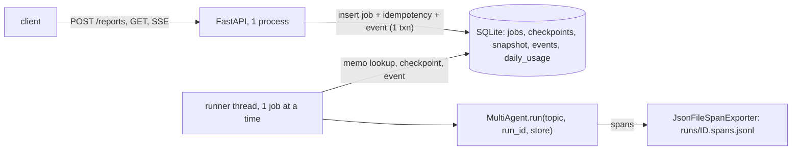
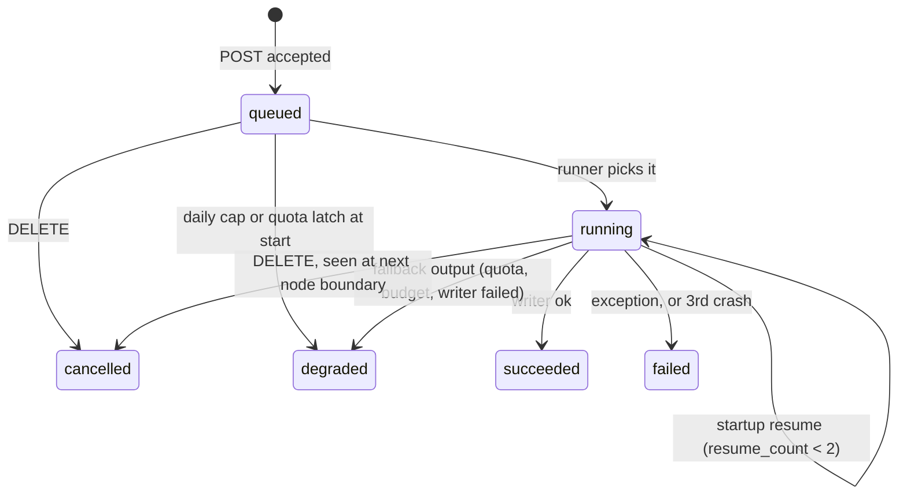

# R4 design: jobs, checkpoints, streaming, traces, deploy

**Goal.** Wrap the R2 multi-agent run in a small FastAPI service: one job at a time, run IDs, idempotent creation, live progress over SSE, and a resume after a crash that reruns only the unfinished nodes (each finished worker is saved when it completes). Deploy it to a Hugging Face Docker Space with strict per-run budgets and a daily cap, because the measured free-tier quota allows only about one or two multi-agent runs per day.

## Components and job states

Terminal states never change: the store updates with `WHERE state IN (<allowed from>)`, so a bad transition updates 0 rows and raises.

## Code layout

New package `src/reporter/service/`: `app.py` (FastAPI, lifespan starts the runner), `store.py` (`JobStore`, stdlib `sqlite3`, WAL, one write connection behind a lock, short-lived read connections), `runner.py` (queue loop, resume, outcome), `quota.py` (daily cap, latch, token bucket), `telemetry.py` (OTel setup and exporter), `config.py` (env), `static/index.html` (one page with vanilla JS EventSource, no build). Agent changes: `MultiAgent.run(topic, *, run_id=None, store=None, hooks=None)`; with `store=None`, behaviour is unchanged (CLI and bench). `BudgetMeter` gets `restore(snapshot)` (sets steps, tokens and cost, then `_start = clock() - elapsed_s`) and an optional `on_call(tokens)` callback. `Trace` gets `resumes: list[dict]`. `Generation` gets `provider: str = ""`.

## Schemas (SQLite)

- `jobs(id PK, state, reason, topic, body_hash, created_at, started_at, finished_at, resume_count INT, cancel_requested INT, crash_hook_fired INT, result_json, usage_json)`. Run id: `rpt_<YYYYMMDDTHHMMSSZ>_<16 hex>` (`secrets.token_hex(8)`, 64 random bits so ids cannot be guessed). It is also `trace.run_id`. GET checks it with a regex (404 otherwise).
- `idempotency(key_hash PK, body_hash, job_id, created_at)`: the key is stored as sha256, never in clear.
- `checkpoints(job_id, key, output_json, created_at, PK(job_id, key))`. Keys: `supervisor`, `worker:<sid>`, `merge`, `critic`, `retry:<sid>`, `regrade`, `writer`. The deterministic checks run inside `critic` and the final citation check inside `writer`, so these are all the node boundaries. `output_json` is the node's return dict, encoded by a pydantic `NodeOutput` model whose fields are optional and match `State`.
- `snapshot(job_id PK, seq, trace_json, meter_json, llm_json)`: latest only, overwritten at every checkpoint. `meter_json` holds `{steps, tokens, cost_usd, elapsed_s}`. `llm_json` holds the router summary so far, added to the previous segments' summary.
- `events(job_id, seq, type, data_json, created_at, PK(job_id, seq))`. `daily_usage(day PK, jobs_started, tokens, llm_calls)` for the UTC day. `quota_latch(id=1, until, reason)`.
- Retention: idempotency rows 24 h; checkpoints are deleted when a job reaches a terminal state; jobs and events 7 days. Purged at startup and once an hour.

## Checkpoint, memo replay and resume

- Every graph node is wrapped by `_checkpointed(key, fn)`. If `key` is in the store, return the saved output (no LLM, no event; a span marked `reporter.node.cached=true`). If the cancel flag is set, raise `JobCancelled`. Otherwise run, then in **one transaction** insert the checkpoint, overwrite the snapshot (trace dumped under `trace._lock`, meter under its lock) and append the node's event(s). After the commit, run `hooks.after_checkpoint(key)`.
- A resume calls the graph again from START with the same `run_id`. Cached `supervisor` gives the same sections, so `_fan_out` sends the same work. Cached `worker:s1` returns at once, and unfinished workers run for real. `critic` is cached with its `retry_ids`, so `_after_critic` repeats its choice. The plan, the fan-out and the retry choice can't drift.
- Before a resume: the meter is restored from `meter_json`, so the time budget continues and downtime does not count. The trace comes from `trace_json` and gets `resumes += {from_key, resumed_at, attempt}`. The LLM gate and the router (`FallbackLLM`, **a new one per job**) start fresh. Steps an in-flight worker made after the last snapshot are lost from the trace and the meter. They are not lost from `daily_usage`, which `on_call` charges on every call.
- Startup: purge, then each `running` job either gets `resume_count+1` and is resumed before any queued job (if `resume_count < MAX_RESUMES=2`) or ends `failed` with reason `crashed_repeatedly`. Queued jobs survive a restart because the queue is the `jobs` table. An exception inside the run is not resumed (a bug would repeat): the job ends `failed` with `internal_error`.
- Test hook: `REPORTER_CRASH_AFTER=<key>` works only when `REPORTER_TEST_HOOKS=1`. It fires once per job, only if `crash_hook_fired=0` (set before it fires, so a restart does not loop), and calls `os._exit(75)`. In-process tests pass a hook that raises `SimulatedCrash(BaseException)` and freezes the store for that job, so the late writes of a dead run are dropped, as they would be in a real process death.

## Admission, queue, quota

POST order: body limit 4 KB (413) -> schema `{"topic": str}`, `extra="forbid"`, 5-300 chars after strip, no control characters (422) -> per-IP token bucket (429) -> idempotency lookup (a replay returns early) -> quota latch (429 `provider_quota`) -> daily cap: `jobs_started + queued + running < DAILY_MAX_JOBS` and tokens left >= 20% of the run token budget (429 `daily_cap`, `Retry-After` until 00:00 UTC) -> queue room: at most `MAX_WAITING=3` waiting (429 `queue_full`) -> one transaction inserts job, key and event `queued`. Answer: 202 `{id, state, links}`.
- Idempotency: `Idempotency-Key` header, 8-128 chars `[A-Za-z0-9_-]`. `body_hash` = sha256 of the canonical JSON of the normalised body (topic stripped, whitespace collapsed). Same key and hash: 200 with the same id and the header `Idempotent-Replayed: true`, whatever the job state. Same key with another hash: 409. No key: always a new job. A rejected POST stores no key. Two concurrent POSTs with one key: the PK conflict makes the loser read the winner's row.
- Runner: one thread and one job at a time (`max concurrent jobs = 1`). It wakes on a `threading.Event` or every 2 s. At start it checks the cap and the latch again: if exhausted, the job ends `degraded` (`daily_cap` or `provider_quota`) with events `quota` and `done` and no LLM call. Run budget = `min(RUN_MAX_TOKENS, tokens left today)`.
- Demo defaults (from env, starting values, not measured): run `max_steps=40, max_tokens=150_000, max_seconds=360, max_cost_usd=0.05`, `max_parallel_workers=2`; `DAILY_MAX_JOBS=2`, `DAILY_MAX_TOKENS=400_000`. Rate limits: POST 3 per IP (refill 1 per 5 min), reads 60 per minute. The bucket map is an LRU of 10k IPs. The client IP is the entry `TRUST_PROXY_HOPS=1` from the right of `X-Forwarded-For`, else the socket peer.
- Quota latch: if a job ends with `per_day_*` or `quota_exhausted` 429s from every configured provider (router `limits`), `until = now + retry_after_s` (or 1 h when no delay is given).

## API (public output)

- `GET /reports/{id}` always returns: `id, state, reason, message, topic, created_at, started_at, finished_at, resume_count`. Then by state. `queued`: `queue_position`. `running`: `progress` (last event type, sections done/total), `budget.used`. `succeeded|degraded`: `result = {report_markdown, sources[{id,title,url}], citation_check{invalid_citations, uncited_sources, unfetched_urls}, sections[{id,title,status,verdict,issue_count}], writer_status}`, `budget{limit, used{steps,tokens,cost_usd,seconds}}`, `trace{llm_calls, total_tokens, cost_usd (null if unpriced), latency_s, models, url:/reports/{id}/trace}`. `failed|cancelled`: no result. `DELETE /reports/{id}`: 202 (a queued job is cancelled now, a running one at the next node), 409 if terminal.
- `message` comes from a fixed `reason -> text` table, e.g. `provider_quota` "The free model quota is used up for now; try again later." Never shown: raw provider errors, `trace.error`, worker errors, step thoughts, idempotency keys, IPs, env values. Logs carry job id, state and reason codes only. A logging filter masks the values of the three API keys. Keys come only from env.
- `GET /health`: `{status, storage: persistent|ephemeral, version}`. `GET /quota`: `{day, resets_at, jobs{used,limit,left}, tokens{used,limit,left}, queue{running,waiting,max}, latch_until}`. `GET /`: the demo page. CORS is off unless `CORS_ORIGINS` is set.

## SSE events

- Vocabulary (fixed): `queued{position}`, `started{resumed, from_key}`, `plan{sections[{id,title}]}`, `worker_done{section_id,status,pages,findings}`, `critic_verdict{stage: first|after_retry, verdicts, retrying}`, `retry{section_id,status,pages,findings}`, `written{writer_status, words}`, `quota{kind: daily_cap|provider_limit, limit_type, resets_at}` (at most once per job), and the terminal events `done{state: succeeded|degraded, reason}` and `failed{state: failed|cancelled, reason}`.
- `id:` is the per-job `seq` (1..n). The store assigns it under the write lock, so order is total within a job. Wire format: `retry: 3000`, then `id/event/data` frames. Resume with the `Last-Event-ID` header or `?after=n`: events with `seq > n` are sent from SQLite (a late subscriber gets the full history), then the stream polls every 1 s, sends `: hb` every 15 s, and closes after a terminal event. A client disconnect only ends the generator; the job keeps running. Max 20 open streams (429). Plain `StreamingResponse`, with no SSE package.

## Observability (OTel API + SDK, own exporter)

- Spans: `job` (root, one per run segment, so a resumed job has 2+ roots), `node:<name>`, `worker:<sid>` (`phase`, `attempt`), `llm.generate` (one per charged call in `generate_charged`, through the OTel **API** only, which is a no-op in CLI and bench), and `tool:<name>` (name, ok, latency; no inputs). Parents are passed explicitly from the job span stored on `WorkerContext`, so the links do not depend on LangGraph copying context into its worker threads.
- Attributes: `gen_ai.operation.name=chat`, `gen_ai.system` (provider), `gen_ai.request.model`, `gen_ai.response.model`, `gen_ai.usage.input_tokens`, `gen_ai.usage.output_tokens`, `gen_ai.usage.cost` (left out when the price is unknown, never 0), `langfuse.observation.type` (`generation|agent|tool|span`), `langfuse.session.id=<run id>` (groups the resumed segments), `langfuse.trace.name=report`. On a failure: status ERROR, `error.type` (class name), `reporter.llm.limit_type`, `reporter.llm.retry_after_s`. Latency is the span duration. No prompts or completions are recorded.
- `JsonFileSpanExporter` (SimpleSpanProcessor) appends `span.to_json()` to `runs/<id>.spans.jsonl`, which survives crashes. `scripts/export_trace.py <id>` writes `docs/traces/example.json` as `{label, synthetic, run_id, exported_at, spans}`. The evaluator exports a real end-to-end run (`synthetic: false`). If the quota blocks every real run, it exports a fake-backed one labelled `"synthetic": true, "label": "fake LLM and tools; numbers are not measurements"`.

## Deploy

- Dockerfile: `python:3.12-slim`, `uv` copied from `ghcr.io/astral-sh/uv`, `uv sync --locked --no-dev`, user uid 1000, `HOME=/home/user`, `EXPOSE 7860`, `CMD .venv/bin/uvicorn reporter.service.app:app --host 0.0.0.0 --port 7860 --workers 1`, `HEALTHCHECK` with python `urllib` on `/health` (the image has no curl).
- Storage: `REPORTER_DATA_DIR`, else `/data` if writable, else `./var` with a WARNING log and `storage: ephemeral` (a restart then loses jobs, so a resume is impossible). `var/` is git-ignored.
- `.github/workflows/deploy.yml`: on push to `main` and `workflow_dispatch`, `concurrency: deploy`. Steps: lint and test, then export only the files the image needs (`Dockerfile`, `pyproject.toml`, `uv.lock`, `src/`, plus `deploy/space_README.md` as `README.md` with `sdk: docker` and `app_port: 7860`) and force-push them to `https://huggingface.co/spaces/${HF_SPACE_ID}` with `HF_TOKEN`. `HF_SPACE_ID` is a repo variable with a default in the file. If `HF_TOKEN` is empty, the job prints `::notice::HF_TOKEN not set, deploy skipped` and succeeds. Then it polls `https://<space>.hf.space/health` for up to 15 min and fails if the Space is not healthy. The owner sets the three provider keys as Space secrets in the PAUSE step.
- New dependencies (main group, because the agent imports the OTel API): `fastapi` and `uvicorn` (plain, not the `[standard]` extras), `opentelemetry-api` and `opentelemetry-sdk`. No collector, no Langfuse SDK, no `sse-starlette`, no `langgraph-checkpoint-sqlite`.

## Deliberately not built

Auth and accounts, multi-tenant isolation, payments, horizontal scaling or more than one uvicorn worker (queue, buckets and the latch live in one process), websockets, a job list endpoint, killing a node mid-call, the baseline system over HTTP, a Langfuse server.

## Design choices

1. **Our own memo store of node outputs, not `langgraph-checkpoint-sqlite`.** The meter, trace and router summary live outside the graph state, so a side store is needed anyway. Per-key memo replay makes "only unfinished workers rerun" obvious and testable, and it costs no package or async driver. Rejected because LangGraph's saver needs a `thread_id` and pending-writes semantics, and it would still not restore the meter or the trace.
2. **The SQLite table is the queue, with one runner thread; no Redis, Celery or RQ.** The Space is one container, queued jobs survive restarts, and the state machine is guarded by SQL. Rejected: a broker means another service to run and pay for.
3. **SSE reads persisted events by polling, rather than an in-memory pub/sub.** One source of truth gives history, `Last-Event-ID` and resume after a restart for free. The cost is up to 1 s of latency, which is nothing next to minutes-long runs.

## Builder watch-outs

- Build a new `FallbackLLM` per job: the router summary is per instance. Merge the restored `llm_json` with it using a recursive integer sum.
- All trace times must come from `meter.elapsed_s` (restored offset), never from raw `clock()`, or resumed workers show negative or overlapping times.
- Take the trace snapshot under `trace._lock`; the regrade and critic dicts are written by single nodes, while steps are appended by threads.
- SQLite: `check_same_thread=False` on the write connection, WAL, `busy_timeout`; never hold the write lock while calling the LLM.
- Gemini daily quotas reset at midnight Pacific time, not UTC; the latch uses the provider's delay or 1 h, never "midnight".
- A real crash test on the Space needs `/data` and a Space restart. Without persistent storage, the evaluator runs the crash test on the same image locally (`docker run -v data:/data`, crash hook, `docker start`) and says so in `results/r4_deploy.json`.
- Push only the exported files to the Space (it rejects binaries without LFS). Never echo `HF_TOKEN`; use `git push` with the token in an env-built URL that is masked.
- The CLI and bench tests must stay green unchanged (`store=None` path).

## Test plan (fakes only, no network; fake clock for time)

1. Idempotency: same key and body give the same id and one job. Different body: 409. No key: two jobs. A key expires after 24 h. Two threads posting one key: one job. A replay works while the queue is full.
2. State machine: every allowed transition. A forbidden one (e.g. succeeded -> running) raises. DELETE on a queued job gives cancelled; on a running job it gives cancelled at the next boundary; on a terminal job, 409.
3. SSE: ids are 1..n in order. `Last-Event-ID: k` sends only `seq > k`. A late subscriber gets the history. A heartbeat is sent after 15 s of fake time. The stream closes after `done` or `failed`. A disconnect mid-run: the job still succeeds.
4. Crash mid fan-out: 3 sections, `SimulatedCrash` after `worker:s1`. A new app on the same DB file resumes the same id. The fake LLM shows 0 new supervisor calls, 0 for s1, and calls for s2 and s3. Final state succeeded, `resume_count=1`, no duplicate events, meter >= snapshot, `trace.resumes` has 1 entry. Three crashes end in `failed` with `crashed_repeatedly`.
5. Daily cap: `DAILY_MAX_JOBS` reached gives 429 `daily_cap` with `Retry-After`. The token cap behaves the same. A queued job that starts after the cap ends degraded with a `quota` event. Fake midnight UTC resets the counters.
6. Provider quota: a fake raises `RateLimitError(limit="per_day_requests")` on all providers. The job ends degraded with `provider_quota`, a `quota` event and the latch set; the next POST gets 429.
7. Queue full (4th waiting POST: 429); rate limit (bucket empty: 429, refill with fake time, `X-Forwarded-For` hop rule).
8. Redaction: a fake error message containing a fake key appears nowhere in GET, events, spans or `caplog`.
9. Validation: long topic 422, unknown field 422, body over 4 KB 413, bad id 404.
10. Telemetry: an in-memory exporter sees node, worker and llm spans with the `gen_ai.*` and `langfuse.*` attributes, worker spans parented to the job span across threads, and no cost attribute when the price is None. The file exporter round-trips.
11. Storage fallback: with no `/data`, a warning is logged and `/health` says `ephemeral`.
